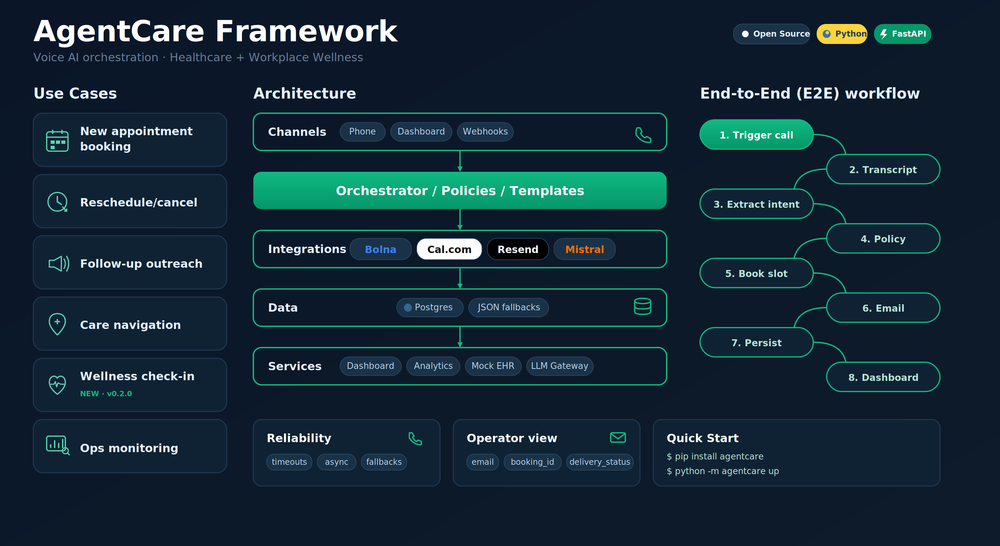
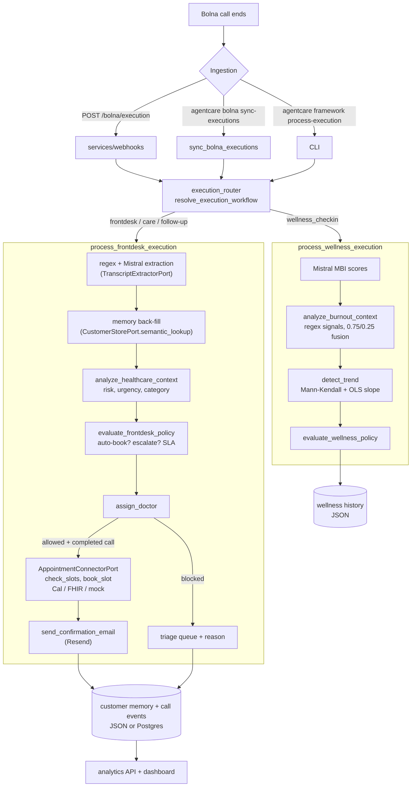
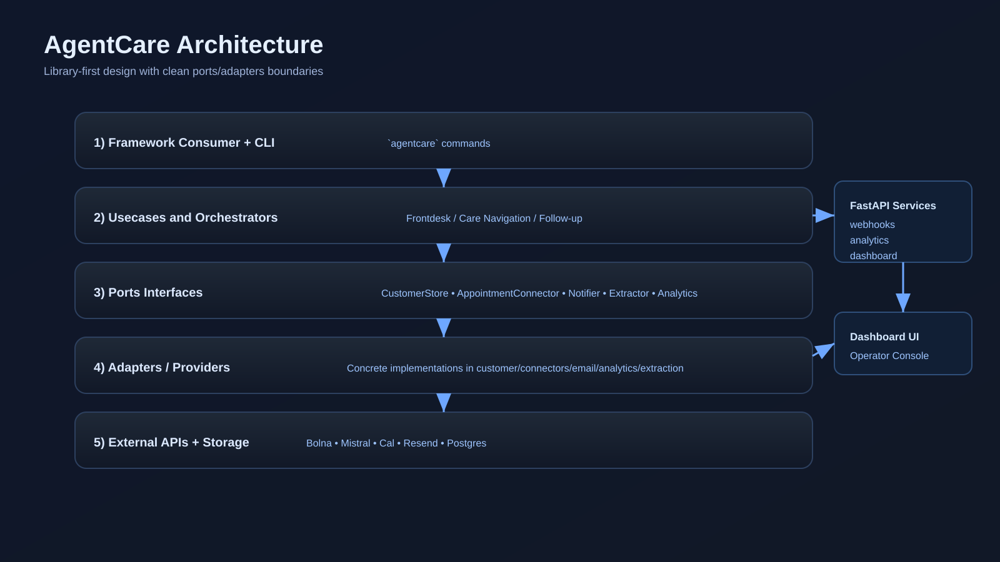
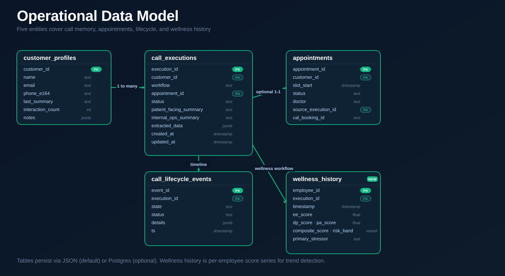

<div align="center">

# AgentCare

**A Python framework for healthcare voice-AI agents: it turns post-call transcripts into triaged, policy-checked bookings, follow-ups and wellness escalations.**

[](https://pypi.org/project/agentcare/)
[](https://pypi.org/project/agentcare/)
[](https://pepy.tech/projects/agentcare)
[](https://github.com/irfanalidv/AgentCare/actions/workflows/ci.yml)
[](https://github.com/irfanalidv/AgentCare/actions/workflows/codeql.yml)
[](https://github.com/irfanalidv/AgentCare/blob/main/LICENSE)
[](https://github.com/astral-sh/ruff)
[](https://mypy-lang.org/)
[](https://github.com/irfanalidv/AgentCare/blob/main/CONTRIBUTING.md)

</div>



## Why

A voice agent can hold the conversation; the hard part is what happens after the call. Someone
has to pull the patient's details out of the transcript, decide whether the request is routine or
urgent, pick the right clinician, book a real slot, confirm by email, and remember the patient next
time. AgentCare is that post-call layer. Every step is a small, replaceable port (calendar, EHR,
email, memory, LLM), and the safety decisions (risk triage, auto-booking policy, escalation) are
deterministic Python you can read and test, with the LLM used only for field extraction.

## Features

| | |
|---|---|
| **Four registered workflows** | `frontdesk_booking`, `care_navigation`, `followup_outreach`, `wellness_checkin`, with Bolna agent specs generated from one registry |
| **Post-call pipeline** | Regex + Mistral extraction, customer-memory back-fill, healthcare risk/category analysis, booking policy, doctor routing, slot check, booking, confirmation email, analytics |
| **Safety-first policy** | High-risk calls (e.g. chest pain, fainting, self-harm cues) are never auto-booked and go to a clinical triage queue; rules are overridable from a JSON file |
| **Appointment connectors** | Cal.com, FHIR R4 (`Slot` search + `Appointment` create) and a mock connector behind one `AppointmentConnectorPort` |
| **Wellness check-ins** | Maslach Burnout Inventory-aligned signals, LLM/regex score fusion, Mann-Kendall trend test, crisis-cue override |
| **Memory and analytics** | Customer profiles and call events in JSON (atomic writes, corruption-safe) or Postgres; KPI, funnel, cohort and case-queue projections |
| **Local stack** | `agentcare up` runs webhook, analytics, dashboard, mock EHR and an OpenAI-compatible LLM gateway (FastAPI) |
| **CLI** | Bolna calls, agents, knowledge bases, execution sync, extraction, evaluation, templates |
| **Typed** | Ships `py.typed`; checked with mypy |

## Install

Requires Python 3.10+.

```bash
pip install agentcare
# or
uv add agentcare            # inside a uv project
uv pip install agentcare    # into the active environment
```

Extras:

```bash
pip install "agentcare[web]"        # FastAPI services (webhooks, analytics, dashboard)
pip install "agentcare[postgres]"   # Postgres-backed customer memory and analytics
pip install "agentcare[email]"      # Resend confirmation emails
pip install "agentcare[semantic]"   # ragfallback + FAISS semantic customer lookup
pip install "agentcare[dev]"        # pytest, coverage, ruff, mypy, pre-commit, build, twine
```

## Quickstart

The analysis and policy layers are plain Python and need no API keys. This scores a check-in
transcript, tests a score series for a trend, and routes the result:

```python
from agentcare.analysis import analyze_burnout_context, detect_trend
from agentcare.policies.wellness import evaluate_wellness_policy

analysis = analyze_burnout_context(
    transcript=(
        "I'm exhausted every single day and I can't switch off. "
        "Honestly I've stopped caring about the team and nothing I do seems to matter."
    )
)
print(analysis.risk_band, round(analysis.composite_score, 2), analysis.ee_tags)
# low 3.14 ['exhaustion_explicit', 'cant_disconnect']

trend = detect_trend([3.1, 3.8, 4.6, 5.2, 6.4, 7.3])
print(trend.direction, trend.triage_trigger)
# deteriorating True

decision = evaluate_wellness_policy(
    risk_band=analysis.risk_band,
    high_acuity_flag=analysis.high_acuity_flag,
    trend_direction=trend.direction,
    triage_trigger=trend.triage_trigger,
)
print(decision.escalation_target, decision.follow_up_sla_hours)
# confidential_human_followup 24
```

A single low-risk session would auto-close; the deteriorating trend is what escalates it. For the
front-desk pipeline end to end (booking, escalation, confirmation), run
[`examples/frontdesk_offline_pipeline.py`](https://github.com/irfanalidv/AgentCare/blob/main/examples/frontdesk_offline_pipeline.py).

The full local stack runs the FastAPI services and helper scripts in the repository, so start it
from a clone:

```bash
git clone https://github.com/irfanalidv/AgentCare && cd AgentCare
pip install -e ".[web]"
cp .env.example .env          # add BOLNA_API_KEY and MISTRAL_API_KEY
python -m agentcare up        # --dry-run validates configuration without starting anything
```

| Service | URL |
|---|---|
| Dashboard | http://127.0.0.1:8050 |
| Analytics API | http://127.0.0.1:8040/healthz |
| Webhooks | http://127.0.0.1:8030/healthz |
| Mock EHR | http://127.0.0.1:8020/healthz |
| LLM gateway | http://127.0.0.1:8010/healthz |

## How it works



Key design decisions:

- **Ports and adapters.** Use cases depend on protocols in `agentcare.ports`
  (`AppointmentConnectorPort`, `CustomerStorePort`, `TranscriptExtractorPort`, ...). Every
  dependency is injected through `FrontdeskDeps` / `WellnessDeps`, which is how the examples and
  tests run the real pipeline offline.
- **The LLM extracts; Python decides.** Mistral fills structured fields under a Pydantic schema.
  Risk level, auto-booking, escalation and SLA come from deterministic analysis and policy code. If
  extraction fails, the fields stay empty, the failure is logged, and the regex layer still runs.
- **Bookings only from completed calls.** Automation runs only for `status == "completed"`;
  transcript-echoed appointment IDs are not trusted for new bookings; high-risk calls are blocked
  from auto-booking by policy.
- **Degrade, don't crash.** Missing keys skip the integration with a reason (`skipped=True`,
  `error="CAL_API_KEY not configured"`) instead of raising mid-pipeline; Postgres falls back to
  JSON when unreachable.
- **Local data is safe to keep.** JSON stores write atomically, and a corrupt file is moved aside
  (`<name>.corrupt-<timestamp>`) instead of being overwritten.

<details>
<summary><b>Package layout</b></summary>

```
src/agentcare/
  usecases/      workflow orchestration (frontdesk, wellness, execution router)
  ports/         protocol interfaces
  connectors/    appointment connectors (Cal, FHIR, mock)
  calendar/      Cal.com client and natural-language slot parsing
  customer/      customer memory (JSON, Postgres; optional semantic lookup)
  email/         Resend notifier
  analysis/      healthcare risk, burnout signals, trend detection
  extraction/    transcript -> structured fields (Mistral)
  policies/      front-desk and wellness decisions
  doctor/        doctor directory and specialty routing
  analytics/     call-event store, KPIs, dashboard projections
  bolna/         Bolna API client and models
  sync/          Bolna execution sync job
  workflows/     workflow registry; templates/ builds Bolna agent specs
  cli.py         Typer CLI

services/        FastAPI apps: webhooks, analytics, dashboard, llm_gateway, mock_ehr
experiments/     reproducible benchmark layer (separate requirements)
```




The four operational entities are `customer_profiles`, `call_executions`, `appointments` and
`call_lifecycle_events`; the wellness workflow adds a per-employee score history. More detail in
[ARCHITECTURE.md](https://github.com/irfanalidv/AgentCare/blob/main/ARCHITECTURE.md) and
[docs/](https://github.com/irfanalidv/AgentCare/tree/main/docs).
</details>

## Use cases and recipes

All four examples run offline with no API keys.

| Script | What it shows |
|---|---|
| [`frontdesk_offline_pipeline.py`](https://github.com/irfanalidv/AgentCare/blob/main/examples/frontdesk_offline_pipeline.py) | A knee-pain call booked with an orthopedist and confirmed; a chest-pain call escalated to clinical triage and never auto-booked |
| [`wellness_trend_monitoring.py`](https://github.com/irfanalidv/AgentCare/blob/main/examples/wellness_trend_monitoring.py) | Six weekly check-ins for one employee: MBI dimension scores, Mann-Kendall trend, escalation from none to manager check-in to confidential follow-up |
| [`fhir_booking_local_server.py`](https://github.com/irfanalidv/AgentCare/blob/main/examples/fhir_booking_local_server.py) | `FHIRAppointmentConnector` searching free `Slot`s and creating an `Appointment` against a localhost FHIR-shaped server |
| [`transcript_triage_batch.py`](https://github.com/irfanalidv/AgentCare/blob/main/examples/transcript_triage_batch.py) | Deterministic triage table (category, risk, specialty, auto-book, queue, SLA) for a batch of transcripts; optional Mistral extraction when `MISTRAL_API_KEY` is set |

<details>
<summary><b>The wellness workflow in detail</b></summary>

`wellness_checkin` runs a short weekly conversational check-in with an employee, scores the
transcript on the three Maslach Burnout Inventory (MBI) dimensions, tracks the score history per
employee, and routes to one of three actions: auto-close, manager check-in, or confidential human
follow-up. It produces routing signals; it does not diagnose.

- `analysis/burnout.py` scores emotional exhaustion, depersonalisation and reduced personal
  accomplishment with a regex taxonomy. `extraction/burnout.py` asks the LLM for 0-10 scores per
  dimension under a Pydantic-validated schema with verbatim quote evidence. The two are fused with
  a 0.75/0.25 LLM/regex weighting.
- `analysis/trend.py` applies the Mann-Kendall test (with tie correction) and an OLS slope to the
  per-employee composite series. A triage trigger fires on three consecutive worsening sessions, a
  composite of 7.0 or more, or a deteriorating trend with the latest composite at 5.0 or more.
- Crisis cues (explicit hopelessness, self-harm references, breakdown language) set a separate
  acuity flag that overrides the policy unconditionally (1-hour SLA, confidential human follow-up).
- History sits behind `WellnessHistoryStorePort`; the default JSON adapter writes
  `artifacts/wellness_history.json`.

Dashboard API:

```
GET /api/wellness/cohort                  cohort summary by latest band
GET /api/wellness/flagged                 employees flagged for follow-up
GET /api/wellness/employee/{employee_id}  full session history + recomputed trend
GET /api/wellness/series?limit=50         per-employee composite trajectories
```
</details>

## Configuration

Settings come from environment variables (a `.env` file in the working directory is read
automatically). The library itself needs none of them; the live stack needs `BOLNA_API_KEY` for
calls and `MISTRAL_API_KEY` for extraction. Without a key, the matching integration is skipped
with a reason rather than failing.

| Variable | Default | Purpose |
|---|---|---|
| `BOLNA_API_KEY`, `BOLNA_BASE_URL`, `BOLNA_AGENT_ID`, `BOLNA_FROM_NUMBER` | -, `https://api.bolna.ai` | Telephony provider, default agent, caller ID |
| `MISTRAL_API_KEY`, `MISTRAL_MODEL` | -, `mistral-small-latest` | Extraction, evaluation, summary polish |
| `AGENTCARE_LLM_GATEWAY_URL`, `AGENTCARE_MOCK_EHR_URL` | `http://localhost:8010/v1`, `http://localhost:8020` | Local service endpoints used in agent specs |
| `APPOINTMENT_CONNECTOR_BACKEND` | `cal` | `cal`, `fhir` or `mock` |
| `CAL_API_KEY`, `CAL_EVENT_TYPE_ID`, `CAL_TIMEZONE` | -, -, `Asia/Kolkata` | Cal.com booking (event type is auto-discovered if unset) |
| `FHIR_BASE_URL`, `FHIR_AUTH_TOKEN`, `FHIR_SCHEDULE_ID`, `FHIR_ORGANIZATION_ID` | - | FHIR R4 connector |
| `FHIR_TIMEOUT_SEC`, `FHIR_SLOT_SEARCH_COUNT` | `10`, `20` | FHIR request timeout and slot page size |
| `RESEND_API_KEY`, `AGENTCARE_EMAIL_FROM` | -, `AgentCare <onboarding@resend.dev>` | Confirmation email (falls back to the Resend test sender if your domain is unverified) |
| `CUSTOMER_STORE_BACKEND` | `auto` | `auto`, `json` or `postgres` |
| `CUSTOMER_STORE_PATH`, `PROCESSED_EXECUTIONS_PATH`, `WELLNESS_HISTORY_STORE_PATH` | `artifacts/*.json` | Local JSON stores |
| `DATABASE_URL` (or `SUPABASE_DB_URL`) | - | Postgres for memory and analytics |
| `FRONTDESK_POLICY_PATH` | - | JSON file overriding the booking policy |

`artifacts/` is git-ignored; do not commit call data or `.env`.

## API overview

| Object | Purpose |
|---|---|
| `usecases.process_agentcare_execution(execution, source, workflow=None, ...)` | Route one post-call payload to the right workflow |
| `usecases.process_frontdesk_execution(execution, source, deps=None, ...)` | Front-desk pipeline; returns `FrontdeskProcessingResult` |
| `usecases.process_wellness_execution(execution, source, deps=None)` | Wellness pipeline; returns `WellnessExecutionResult` |
| `usecases.FrontdeskDeps`, `usecases.WellnessDeps` | Dependency containers for injecting your own adapters |
| `analysis.analyze_healthcare_context`, `analyze_burnout_context`, `detect_trend` | Deterministic analysis |
| `policies.evaluate_frontdesk_policy`, `evaluate_wellness_policy` | Decisions (auto-book, escalate, SLA) |
| `doctor.assign_doctor`, `load_doctor_schema` | Specialty routing over a doctor directory |
| `connectors.CalAppointmentConnector`, `FHIRAppointmentConnector`, `MockAppointmentConnector`, `get_appointment_connector()` | Booking adapters |
| `customer.CustomerMemoryStore`, `PostgresCustomerMemoryStore`, `get_customer_store()` | Customer memory |
| `extraction.extract_conversation_fields`, `extract_burnout_fields` | Mistral extraction into Pydantic models |
| `bolna.BolnaClient` | Bolna API: agents, calls, executions, voices, knowledge bases |
| `workflows.WORKFLOW_REGISTRY`, `orchestrator.Orchestrator` | Workflow registry; create a Bolna agent from a workflow |

<details>
<summary><b>CLI reference</b></summary>

```bash
agentcare doctor                                  # effective configuration, no secrets
agentcare init-artifacts                          # create artifacts/
agentcare up --dry-run                            # validate the local stack config
agentcare framework list-workflows                # registered workflows (JSON)
agentcare framework create-agent --workflow wellness_checkin
agentcare framework process-execution --execution-json call.json [--workflow wellness_checkin]
agentcare framework provider-test                 # check provider connectivity
agentcare extract transcript call.txt             # Mistral field extraction
agentcare eval transcript call.txt                # LLM quality evaluation of a call
agentcare customer upsert --name Ava --email ava@example.com
agentcare customer lookup --query "knee pain"
agentcare templates frontdesk --out agent.json    # Bolna agent spec
agentcare bolna voices | call | execution | create-agent | sync-executions
agentcare bolna kb create-url | create-pdf | list | get | delete
```
</details>

## Research and references

The wellness layer builds on:

- **Maslach Burnout Inventory dimensions** (emotional exhaustion, depersonalisation, reduced
  personal accomplishment): C. Maslach and S. E. Jackson, "The measurement of experienced burnout,"
  *Journal of Occupational Behaviour* 2(2), 99-113, 1981. AgentCare maps conversational cues to these
  dimensions; it does not administer or reproduce the MBI questionnaire.
- **Mann-Kendall trend test**: H. B. Mann, "Nonparametric tests against trend," *Econometrica*
  13(3), 245-259, 1945; M. G. Kendall, *Rank Correlation Methods*, Griffin, 1975 (variance with tie
  correction as implemented in `analysis/trend.py`).

## Reproducible experiments

`experiments/` is a separate benchmark layer (scikit-learn, numpy, matplotlib); the runtime does not
need it.

```bash
pip install -r experiments/requirements.txt
bash scripts/run_all_experiments.sh
```

The script generates a deterministic synthetic corpus (180 employees, 8 sessions each, seed 42)
and runs four experiments: extraction quality, trend detection across window sizes, predictive
modelling at a four-session horizon with a feature ablation, and adversarial robustness on
edge-case transcripts. Outputs land in `experiments/output/`.

Regex-only run (no LLM) on the default seed, re-run for this README on 2026-10-31:

| Experiment | Metric | Value |
|---|---|---|
| Trend detection, window = 8 | Accuracy | 0.972 |
| Predictive, logistic regression (test n = 27) | F1 | 0.952 |
| Predictive, logistic regression (test n = 27) | ROC-AUC | 0.997 |
| Adversarial edge cases (n = 12) | Band accuracy | 0.833 |
| Adversarial edge cases (n = 12) | Band false positives | 0 |

These numbers validate the pipeline mechanics on synthetic data generated by the same project; they
are not claims about real-world burnout detection. See
[experiments/README.md](https://github.com/irfanalidv/AgentCare/blob/main/experiments/README.md) for
interpretation and limitations.

## When to use it

- **Good fit:** you run (or plan) a voice agent for a clinic or HR wellness line and need the
  post-call layer: extraction, triage, booking, confirmations, memory and dashboards, with the
  safety logic in reviewable code.
- **Not a fit as-is:** clinical decision support or diagnosis, or regulated production use without
  your own compliance review (consent, PHI handling, BAAs, audit logging). The keyword risk rules
  are a conservative routing aid, not a clinical triage protocol.

## Roadmap

- Postgres adapter for the wellness history store.
- More EHR connectors on the FHIR path (vendor sandboxes) and Cal.com v2-only flows.
- Pluggable LLM providers for extraction beyond Mistral.
- Human-labelled transcripts to evaluate extraction and triage beyond the synthetic corpus.

## Project context

The healthcare workflows (`frontdesk_booking`, `care_navigation`, `followup_outreach`) and the
framework itself are an independent open-source project published on PyPI under the MIT license.
The `wellness_checkin` workflow and the `experiments/` benchmark layer were added in v0.2.0
(April-May 2026) as the deliverable for the M.Sc. Data Science & AI individual project at the
Indian Institute of Science Education and Research (IISER) Tirupati. The methodology (MBI dimension
mapping, Mann-Kendall trend detection, predictive modelling at a multi-session horizon) and the
experimental results are documented in the project's end-semester report.

## Contributing, security, citation, license

- [CONTRIBUTING.md](https://github.com/irfanalidv/AgentCare/blob/main/CONTRIBUTING.md): setup and
  checks (`ruff check .`, `ruff format --check .`, `mypy`, `pytest --cov=agentcare`,
  `pre-commit install`).
- [SECURITY.md](https://github.com/irfanalidv/AgentCare/blob/main/SECURITY.md): private
  vulnerability reports. `scripts/check_no_secrets.sh` is a local pre-push safety check.
- [CHANGELOG.md](https://github.com/irfanalidv/AgentCare/blob/main/CHANGELOG.md): release history.
- Cite via [CITATION.cff](https://github.com/irfanalidv/AgentCare/blob/main/CITATION.cff)
  (GitHub's "Cite this repository" button).
- [MIT License](https://github.com/irfanalidv/AgentCare/blob/main/LICENSE).
